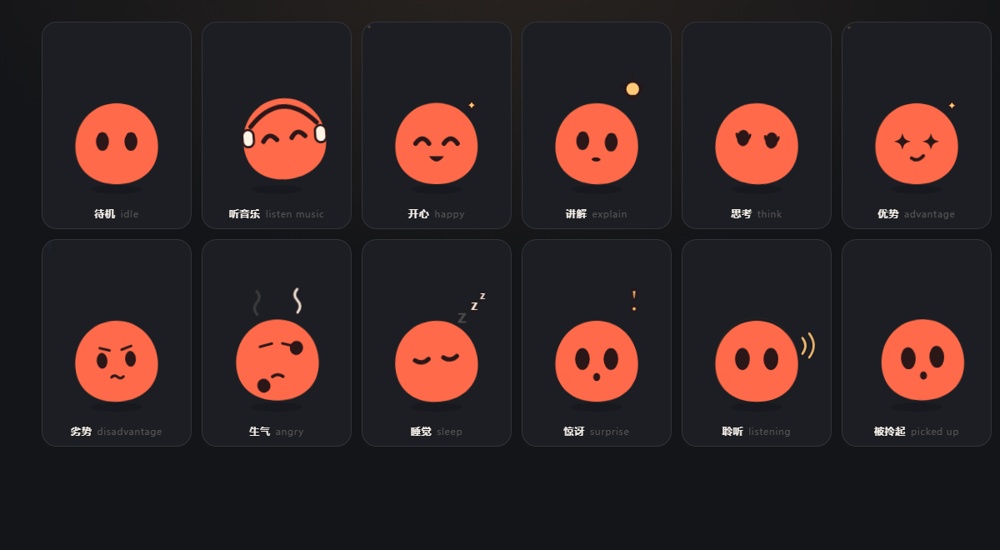

# 灵泡 · 默认桌宠角色设计提案

> 状态：**提案（未接入运行时）**。本文只描述造型、状态系统与接入方案；没有改动 `design/anim/tracks.manifest.json`、`public/pet/` 或 Rust 内置角色表。
> 可交互样张：[`../sheets/state-preview.html`](../sheets/state-preview.html)（状态 / 配色 / 深浅桌面，眼睛跟随鼠标）
> 听音乐实验：[`../sheets/music-lab.html`](../sheets/music-lab.html)（真实音频分析：舒缓 / 轻快 / 激烈三档）
> 听音乐 · 完整界面：[`../sheets/lingpao-groove.html`](../sheets/lingpao-groove.html)（把 Bubble Groove 的泡泡换成灵泡：真实本地音乐分析 + 三档滞回 + 眼神跟随 + 阈值调节）
> 朝向实验：[`../sheets/motion-lab.html`](../sheets/motion-lab.html)（八方向、整圈旋转、程序生成）
> 状态总表：[深色](../sheets/lingpao-states-dark.png) / [浅色](../sheets/lingpao-states-light.png)
> 听音乐截图：[`../sheets/lingpao-music.png`](../sheets/lingpao-music.png)
> 完整界面截图：[`../sheets/lingpao-groove.png`](../sheets/lingpao-groove.png) / 三档：[`../sheets/lingpao-groove-states.png`](../sheets/lingpao-groove-states.png)
> 朝向实验截图：[`../sheets/lingpao-motion-lab.png`](../sheets/lingpao-motion-lab.png)
> 单角色源稿：[`../sheets/lingpao-idle.svg`](../sheets/lingpao-idle.svg)

---

## 0. 一句话

一个**纯色的小团子**：梨形圆身、两只竖椭圆眼睛，没有手、没有脚、没有芽。所有状态由同一套 SVG 骨架的 4 个离散参数（眼 / 嘴 / 身体 / 道具）加上 2 个连续参数（视线 / 倾斜）组合而成。



---

## 1. 设计目标与取舍

需求是「简单、可用 SVG 生成、表现力强」。三者互相拉扯，这一版选择继续做减法：

| 目标 | 做法 | 代价 |
| --- | --- | --- |
| 简单 | 纯色块、无描边、无四肢，只有一个主体轮廓 | 细节极少，必须靠眼睛和身体形变补 |
| SVG 可生成 | 圆、椭圆、圆头描边、四角星；无位图、无渐变、无滤镜 | 质感偏平，不能做玻璃/发光 |
| 表现力强 | 眼睛、嘴、身体形变、道具、节拍反应五个通道 | 需要一套状态参数表，而不是一堆散图 |

砍掉手和芽之后，新增的表达通道是**动态**：呼吸、漂浮、眨眼、跟随鼠标、随音乐摇摆和踩鼓点。这些不占资源，却比多画两个部件更能让人觉得“活着”。

---

## 2. 参考

**Grok Bot（极简语言）**：单色实心块、无描边、只留两只眼睛、轮廓优先、同一骨架换颜色就是新角色。
取：纯色、无描边、眼睛占比大、色板可换。
不取：只考虑深色背景（桌宠贴在任意壁纸上，离体道具必须描边）；完全没有嘴（讲解状态需要说话开关）。

**Bubble Groove（听音乐原型）**：一个没有手脚的泡泡，舒缓时闭眼呼吸并缓慢漂浮，轻快时睁眼左右摇摆，激烈时才在鼓点上弹跳；三档状态用滞回阈值切换，避免在边界来回抖。
取：三档运动逻辑、滞回阈值、双正弦漂浮、按鼓点弹跳、能量条与状态标签。
不取：玻璃质感和蓝紫配色（与本项目品牌色不符）。

> 替换成片见 [`../sheets/lingpao-groove.html`](../sheets/lingpao-groove.html)：保留三档运动、滞回阈值与节拍时钟，把泡泡换成灵泡，界面改成角色色板。

---

## 3. 角色设定

> 器灵醒来时，先是一点光。光凝成一颗圆滚滚的小团子，没有手脚，也不会走路，但很会听。开心的时候会弹起来，想事情的时候会歪着头，听到音乐时会闭着眼睛轻轻晃。

- 定位：器灵的「本灵」，产品默认角色；诗琚是棋灵，属于角色之一，不再是唯一的门面。
- 性格：好奇、温和、有点憨；不抢话，但情绪很明显。
- 声音/语气建议：与现有默认音色一致，不做改动。

---

## 4. 造型规范

### 4.1 画布与比例

| 项 | 值 |
| --- | --- |
| 画布 | `180 × 240`（与现有姿势轨一致，窗口 210×270 内居中） |
| 主体尺寸 | 宽 110（x 35–145）× 高 108（y 101–209） |
| 眼睛 | 竖椭圆 `rx 8.6 / ry 12.4`，中心 (71, 152) 与 (109, 152) |
| 眼距 | 38px，约 1.2 个眼宽 |
| 嘴 | 中心 (90, 176)，默认不画 |
| 落地阴影 | 椭圆 (90, 216) `rx 34 / ry 6`，黑 14% |

比例原则：**身体接近 1:1，眼睛占身体宽 16%，五官集中在身体高度 45% 以上**。缩到 32px 时，仍能读出“有脸”。

### 4.2 配色

| 角色 | 色值 | 用途 |
| --- | --- | --- |
| 主色 珊瑚 | `#FF6B4A` | 身体 |
| 深色 珊瑚 | `#E8502F` | 腮红加深、暗部细节 |
| 墨色 | `#2B1618` | 眼睛、嘴、道具描边 |
| 奶油 | `#FFF3E6` | 耳机、Zzz、蒸汽、省略号 |
| 金 | `#FFC978` | 灯泡、星星、音符、声波 |
| 天蓝 | `#8FCBFF` | 汗滴（唯一冷色，专用于“不妙”） |

最多 6 色。**主色 + 深色是 CSS 变量**，换这两个值就能整套换肤（薄荷、薰衣草、黄油、莓红已在样张里验证）。

### 4.3 轮廓与描边规则

- 身体：**无描边**。没有四肢，也就不存在接缝问题。
- 所有**离开身体的道具**（耳机、音符、灯泡、省略号、汗滴、蒸汽、Zzz、感叹号、声波）：`2–3px` 墨色描边。这是为了在浅色/花哨壁纸上不糊掉。
- 不用渐变、不用 `filter`、不用阴影贴图；落地阴影是纯色椭圆。

### 4.4 不要做的事

- 不要加高光、玻璃质感、内发光——会破坏“纯色块”的统一感；
- 不要把眼睛画成白色眼白 + 瞳孔——竖椭圆纯墨色才是识别点；
- 不要给身体描边；
- 不要堆细节（腮红、纹样、毛边），小尺寸下全糊；
- 不要加回手/脚/芽：目前所有状态已经能靠眼睛、身体和道具表达，加回去只会让轮廓变脏。

---

## 5. 状态系统

### 5.1 通道

| 通道 | 取值 | 作用 |
| --- | --- | --- |
| `eye` | `open / happy / closed / lookup / angry / worry / wide / star` | 主情绪 |
| `mouth` | `none / talk / grin / smirk / wavy / pout / o` | 说话与强情绪，**默认 none** |
| `body` | 呼吸 / 漂浮 / 弹跳 / 抖动 / 下沉 / 拉长 | 情绪强度，全部是 transform |
| `prop / fx` | 耳机、音符、灯泡、省略号、汗滴、蒸汽、Zzz、感叹号、声波 / 星星、音符、波纹 | 语境，一眼定状态 |
| `gaze` | 眼睛平移 ±7px，身体倾斜 ±11° | 此刻在看哪（连续量，跟鼠标） |

### 5.2 状态矩阵

| 状态 | 运行时对应 | 眼 | 嘴 | 身体 | 道具/特效 |
| --- | --- | --- | --- | --- | --- |
| 待机 | `idle` | open | — | 呼吸 + 漂浮 + 眨眼 | — |
| 听音乐 | idle beat | happy | — | 轻摆 | 耳机 + 音符 |
| 开心 | idle beat（可选） | happy | grin | 弹跳 | 星星 |
| 讲解 | `explain` | open | talk | 前倾 | 灯泡 |
| 思考 | `think` | lookup | — | 歪头 | 省略号 |
| 优势 | `advantage` | star | smirk | — | 星星 |
| 劣势 | `disadvantage` | worry | wavy | 后仰 | 汗滴 |
| 生气 | `angry` | angry | pout | 抖动 | 蒸汽 |
| 睡觉 | 新增 | closed | — | 下沉 | Zzz |
| 惊讶 | 新增 | wide | o | 弹起 | 感叹号 |
| 聆听 | 唤醒词命中 | wide | — | — | 声波 |
| 被拎起 | `drag.holding` | wide | o | 拉长 | — |

> 现有五态（idle / think / explain / advantage / disadvantage）全部覆盖；angry 继续做待机节拍；新增的「听音乐 / 睡觉 / 惊讶 / 聆听」是后续可用的扩展。
> 表格里的「听音乐」是状态总表用的**静态姿势**；真正的动态听音乐在 §5.5，由音频实时驱动。

### 5.3 参数接口（实现建议）

```ts
type Eye = 'open' | 'happy' | 'closed' | 'lookup' | 'angry' | 'worry' | 'wide' | 'star'
type Mouth = 'none' | 'talk' | 'grin' | 'smirk' | 'wavy' | 'pout' | 'o'
type Prop = 'none' | 'music' | 'bulb' | 'dots' | 'sweat' | 'steam' | 'zzz' | 'bang' | 'ear'
type Fx = 'none' | 'sparkles' | 'notes' | 'ripple'

interface Pose {
  eye: Eye; mouth: Mouth
  prop: Prop; fx: Fx
  gaze: { x: number; y: number }  // ±1，连续量（跟鼠标）
  tilt: number                    // 角度，±20
}
```

状态机只输出 `Pose`，组件只负责把 `Pose` 画出来。新增状态 = 在 `POSES` 里加一行。

> 离散参数（眼/嘴/道具）负责“是什么状态”，连续参数（gaze/tilt）负责“此刻在看哪”。两者正交，可以叠加：例如「思考」状态也能一边看鼠标。

### 5.4 眼神跟随与待机

**眼神跟随**（`state-preview.html` 与 `music-lab.html` 已实现）

- 眼睛整体最多平移 `±7px`，身体最多倾斜 `±11°`；斜向时倾斜收小到 `±7°`。
- 眼睛平移是主线索，身体倾斜是放大器：只移眼睛方向感偏弱，加上倾斜立刻成立。
- 平滑：每帧向目标插值（`0.18`），或 CSS `transition .12s`；不要直接吸附。
- 浏览器里用 `pointermove`；**真机上桌宠窗口只有 210×270，鼠标大多数时候在窗口外**。Tauri v2 的 `@tauri-apps/api/window` 已提供 `cursorPosition()`，以 10–15Hz 轮询全局光标，算方向后写入 `--gx/--gy` 即可，不要用 `pointermove` 冒充全局跟随。

**待机**

- 漂浮：两条互质正弦叠加（0.48 / 0.22 rad/s），上下约 ±7px + 2px，避免机械循环。
- 呼吸：`scale(1.012, .996)`，约 4s 一轮，origin 在底部。
- 眨眼：每 3.2–6.8 秒随机一次，闭合约 130ms；不要固定 5 秒整，容易看出是循环。
- 阴影跟随高度缩放/淡出，让“浮起来”有重量感。

### 5.5 听音乐（三档）

照搬 Bubble Groove 的运动分层，但换成灵泡的脸：

| 状态 | 触发 | 眼睛 | 运动 |
| --- | --- | --- | --- |
| 舒缓 | 能量 < 0.24 | 闭眼笑（∩） | 慢呼吸 + 缓慢漂浮，**不上下弹跳** |
| 轻快 | 0.32 ≤ 能量 < 0.60 | 睁眼 | 只左右摇摆 + 轻微倾斜，**不上下跳** |
| 激烈 | 能量 ≥ 0.52 | 睁眼张嘴 | 摇摆加大，每一拍向上弹起并压扁 |

- **滞回阈值**：进入轻快 0.24、回落到舒缓 0.16；进入激烈 0.52、回落到轻快 0.42。两个阈值留缓冲，避免在边界反复切换表情。
- **节拍时钟**：动作由节拍驱动，而不是只在检测到鼓点时抖一下。每一拍身体从一侧连续摆到另一侧，下一拍反向；激烈档在每一拍向上弹起并压扁。即使音频分析失败或 AudioContext 被挂起，画面也按页面时钟继续跳。
- **起播即轻快**：点播放先摇起来，再根据能量升到激烈或降到舒缓；不会一上来停在闭眼漂浮。
- **预览三档**：面板上的“预览 · 舒缓 / 轻快 / 激烈”可以不听音频直接看三档动作，用来确认效果。
- **能量**：低音（35–160Hz）+ 中频 + RMS 加权，再乘一个用户可调的“强度”；自动演示时用慢 LFO 让强度起伏，正好能看全三档。
- **节拍**：BPM 时钟每拍触发一次 `pulse`；激烈档用它来弹跳，低频能量只用来决定停在哪个档位。
- **腿？没有腿**：弹跳靠整体 `translateY` + 压扁/拉长，落地时压扁、离地时拉长；摇摆绕底部（90, 209）旋转，读起来像“摇头”。
- **音频来源**：设计原型用浏览器合成的底鼓/踩镲/低音，另支持本地音乐解码播放（纯本机，不上传）；本地音乐用 10ms 能量包络 + 自相关估一个 BPM，估不准时退回 96，至少让摇摆跟歌速一致，但没有做逐拍对齐。真机的音频源应是器灵自己的播报/播放，或后续接系统音频回环，不要假设能随便抓别人的音乐。
- **成本**：全部是 `transform` + 一个 `AnalyserNode`，没有逐帧资源。
- **成片界面**：`sheets/lingpao-groove.html` 把上面这套逻辑搬进完整界面：libsonare 检测 BPM 与逐拍时间、波形条、三档预览、阈值实时调节、眼睛跟随鼠标。三档参数与此表一致（轻快 12px / 7°，激烈 18px / 10° + 26px 弹跳），默认滞回 0.24 / 0.16 与 0.52 / 0.42。
- **耳机**：音乐响起（进入三档任一档，含状态预览）时戴上耳机，暂停即摘下。耳机带是奶油色芯 + 墨色描边，杯体在头两侧——纯墨色带在展示尺寸下会像一道横在额头的黑箍，加奶油芯后才读得出「耳机」。

### 5.6 朝向、旋转与生成

没有脖子、没有独立头部，整个身体就是头，所以“看”和“转”都只是在分组上做 transform。

| 方向 | 眼睛平移 | 身体倾斜 |
| --- | --- | --- |
| 左 / 右 | ±7–9px | ±11° |
| 上 / 下 | ±6–7px | 0（下看时用同色矩形压上眼皮） |
| 斜向 | ±6–8px | ±7° |

- **整圈 360°**：转整体分组，适合开心转圈、被拎起晃一圈；眼睛跟着转，读作翻跟头。
- **背过身**：隐藏眼睛 + 快速翻转，1 秒内的短表演（害羞、不理你）；2D 没有真正的背面，不能长时间停留。
- **程序生成**：同一套五官 + 4 种轮廓（梨/圆/圆角方/豆）+ 8 组配色 + 随机倾斜与视线，一个 seeded PRNG 一次生成一排。器灵本体只保留一种轮廓，多轮廓留给自定义角色或节日皮肤。

---

## 6. 动效规范

| 动作 | 时长 | 说明 |
| --- | --- | --- |
| 漂浮 | 连续正弦 | 两条互质波，上下 ±7px + 2px |
| 呼吸 | 3.8–4s | `scale(1.012, .996)`，origin 底部 |
| 眨眼 | 3.2–6.8s 随机，130ms | 眼组 `scaleY .08` |
| 说话嘴 | 150ms | `scaleY 1 ↔ .3`，`steps(2)` |
| 弹跳（开心） | 950ms | 落地压扁 `.93`，起跳拉长 `1.07` |
| 抖动（生气） | 400ms | `translateX ±2.4px` + 旋转 ±1.4° |
| 摇摆（轻快） | 跟随 BPM | 左右各 12px + 倾斜 7°（绕底部，像摇头） |
| 踩鼓点（激烈） | 跟随鼓点 | 向上 26px + 压扁，左右各 18px + 倾斜 10° |
| 道具入场 | 260ms | `scale .5 → 1.1 → 1`，overshoot |

**硬约束**

- 只动 `transform` 和 `opacity`；不动 `filter`、不逐帧改 `d`、不用 SMIL。
- 循环动画相位错开，避免“整屏一起眨眼”。
- `prefers-reduced-motion: reduce` 时全部关闭，只保留静态姿态。
- 运行时只渲染一个角色；多状态同屏只存在于设计样张。

---

## 7. SVG 实现规范

### 7.1 图层顺序

```
<svg viewBox="0 0 180 240">
  ground            落地阴影
  fx                身体后方的特效（波纹、星星）
  <g class="float"> 漂浮
    <g class="body"> 呼吸形变（origin 底部）
      body          身体
      <g class="gaze">
        eyes        眼睛（gaze 负责平移，eye 负责眨眼）
      </g>
      mouth         嘴（默认不画）
    </g>
  </g>
  props             道具（最上层，带墨色描边）
</svg>
```

### 7.2 工程约定

- 每个部件加 `data-part`（`body`/`eye-l`/`eye-r`/`mouth`/`prop`/`fx`），方便属性驱动。
- 配色全部走 CSS 变量：`--body`、`--body-deep`、`--ink`、`--cream`、`--gold`、`--sky`。
- **Zzz / 省略号不要用 `<text>`**：SVG 文字依赖字体，换机器会变形。样张为了省事用了 `<text>`，实现时必须改 path。
- 眼睛的眨眼与视线分两层：`gaze` 管平移，`eye` 管 `scaleY`，否则两个 transform 会打架。
- 体积预算：基础骨架 ≤ 3KB，含全部道具 ≤ 8KB（gzip 前）。
- `role="img"` + `aria-label="器灵，<状态名>"`；语义主要仍由语言气泡承担。

### 7.3 与位图轨的关系

- **不进** `design/anim/tracks.manifest.json`，**不进** `npm run bake:anim`，**不进** 资源包格式。
- 理由：bake 遇到未知 `asset.type` 会直接抛错；资源包只收 WebP/PNG；manifest 的轨是位图模型。
- 第三方角色资源包继续走既有 WebP/PNG 规范，完全不受影响。

---

## 8. 接入运行时的方案（基于代码审计）

当前运行时只有 `shiju` 一个内置角色，且 Rust 侧是单例假设。要成为「默认角色」，改动分两层：

### 8.1 前端渲染（可先做，不动 Rust）

| 文件 | 改动 |
| --- | --- |
| 新增 `src/pet/SvgSprite.tsx` | 接收 `Pose`，渲染内联 SVG；`pointer-events: none`，指针事件仍留给 `.pet-sprite` |
| `src/pet/PetApp.tsx` | 在 `` 同一位置加分支：内置角色且 renderer 为 svg 时渲染 `SvgSprite`；绕过 `poseSrc` 对 `/pet/*.webp` 的回退 |
| `src/index.css` | `.pet-sprite` 内补 SVG 尺寸（180×240）与 `pointer-events` |
| `src/pet/states.ts` | 新增 `poseForState()`：把 `stateId + speaking + holding` 映射成 `Pose`；不改现有五态 id |

要点：

- `key={state.id}` 的强制重挂载只适用于 ``；SVG 用 props 更新，不要重挂。
- 现有 `.pet-arrive` 的 `drop-shadow` 不要和 SVG 内的落地阴影叠加。
- 说话嘴由 `speech.speaking` 驱动；`phase === 'thinking'` 直接用 `lookup` 眼。
- **眼神跟随**：浏览器预览用 `pointermove`；Tauri 里用 `cursorPosition()` 轮询（10–15Hz），窗口外也能看向鼠标。
- **拖拽**：不要伪造 `frameSequence`；SVG 角色用 `drag.holding` 切换「被拎起」姿态（拉长 + 摆动）。窗口本身已经跟手，不要再额外 `translate`，否则会双倍位移并在 210×270 窗口边缘裁切。
- **听音乐**：需要一个 `AnalyserNode` 与 rAF 循环；只在播放时启动，停止后回到 CSS 待机，避免空转。
- React 每次 line/beat 都会重渲染，`SvgSprite` 用 `memo` 包一层。

### 8.2 内置角色注册（成为默认角色必须做）

| 文件 | 改动 |
| --- | --- |
| `src-tauri/src/pet_pack.rs` | `BUILTIN_ID/NAME` 单例 → 内置角色表；`state.json` 的默认值与非法回退；`packs_view` 列出多个内置；内置缩略图（现硬编码 `/pet/idle.webp`）；`set_active`/`uninstall`/`load_runtime` 守卫；预留新 id 防资源包占用 |
| `src/pet/packs.ts` | `BUILTIN_CHARACTER` → 映射；`loadCharacterAssets` 按 id 分支；`ActiveCharacter` 增加 renderer 标记（Rust/TS 同步） |
| `src/pet/PacksApp.tsx` | 内置卡片描述与缩略图 |
| `docs/multi-character-animation-spec.md` | 补「内置 SVG 角色」与资源包的边界说明 |

> `loadCharacterAssets` 对内置角色只读内置 manifest；SVG 角色需要一条独立的 `renderer: 'svg'` 分支，不要混进 `tracks`。

### 8.3 尺寸与性能

- 窗口固定 210×270，姿势区 180×240（pickup 轨 180×260）；SVG 必须显式给 `width/height`，否则默认 300×150。
- SVG 是矢量的，不受 devicePixelRatio 影响；只有现有的 `PickupSprite` canvas 需要 DPR 处理。
- 避免动画 `filter`；WebView2 下 CSS transform/opacity 走合成层，开销可忽略。
- 音频分析用 `AnalyserNode` + rAF，播放停止即停；不要常驻分析器。

---

## 9. 落地阶段

| 阶段 | 内容 | 是否动 Rust |
| --- | --- | --- |
| P0（本提案） | 造型 + 12 状态 + 眼神跟随 + 待机 + 听音乐三档 + 朝向实验 | 否 |
| P1 | `SvgSprite` + 五态映射 + 眨眼/漂浮/说话嘴，挂在 `?renderer=svg` 预览后 | 否 |
| P2 | Rust 内置角色表 + 默认角色切换 + 设置页缩略图 | 是 |
| P3 | 待机节拍（音乐/睡觉/生气）、`drag.holding` 拎起形变、多配色 | 否 |
| P4 | 可选：把 SVG 离线烘焙成 WebP，供分享图/资源包模板使用 | 否 |

P1 的关键是**不改默认角色**，先用 URL 开关验证真机效果；P2 再改默认，避免美术未定稿就动 Rust 单例。

---

## 10. 验收标准

- 180×240、1x 下五官清晰；缩到 32px 仍能认出轮廓。
- 浅色、深色、花哨壁纸三种背景下都不糊（道具描边可读）。
- 12 个状态不看文字，至少能认出 8 个。
- 八方向注视不看文字，左右、上、下可辨。
- 待机 30 秒内眨眼 4–8 次，且间隔不规律。
- 听音乐三档：舒缓不明显弹跳、轻快不上下跳、激烈只踩鼓点弹跳；边界不抖。
- 单个 SVG（含全部道具）≤ 8KB。
- WebView2 下稳定 60fps，无滤镜动画。
- `prefers-reduced-motion` 下无非必要动画。
- 现有资源包安装、切换、卸载行为完全不变。

---

## 11. 待定问题（需要产品/美术拍板）

1. **名字**：灵泡 / 灵崽 / 小灵？`lingpao` 只是占位 id。
2. **诗琚怎么办**：保留为第二个内置角色，还是降级为可安装资源包？
3. **要不要嘴**：绝对极简（永远两只眼）还是保留“说话才出现嘴”？提案选后者。
4. **默认配色**：珊瑚（品牌色）还是更中性的奶油白？
5. **听音乐的音源**：只跟器灵自己的播报/播放，还是做系统音频回环（会引入权限与延迟问题）？

---

## 附：文件清单

```
design/characters/lingpao/
  docs/
    灵泡-角色设计提案.md        # 本文
  sheets/
    lingpao-idle.svg            # 单角色源稿（待机）
    state-preview.html          # 12 状态样张（眼睛跟鼠标）
    music-lab.html              # 听音乐实验（三档 + 音频分析）
    lingpao-groove.html         # 听音乐 · 完整界面 demo（Bubble Groove 的泡泡换成灵泡）
    motion-lab.html             # 朝向/旋转/生成实验
    lingpao-states-dark.png     # 状态总表·深色
    lingpao-states-light.png    # 状态总表·浅色
    lingpao-music.png           # 听音乐·激烈档截图
    lingpao-groove.png          # 完整界面截图（本地音乐播放中）
    lingpao-groove-states.png   # 完整界面三档截图：舒缓 / 轻快 / 激烈
    lingpao-dance-strip.png     # 同一拍的 4 帧：离地 → 落地 → 离地 → 落地
    lingpao-motion-lab.png      # 朝向/旋转/生成截图
  _workshop/
    preview.png                 # 整页预览截图（工作稿）
    music-*.png                 # 听音乐各档工作截图
```

> 本提案未修改 `design/AGENTS.md` 的角色表、`tracks.manifest.json`、`public/pet/` 与任何 Rust/TS 运行时代码。定稿后再按 `design/AGENTS.md` 的目标树登记角色与轨。